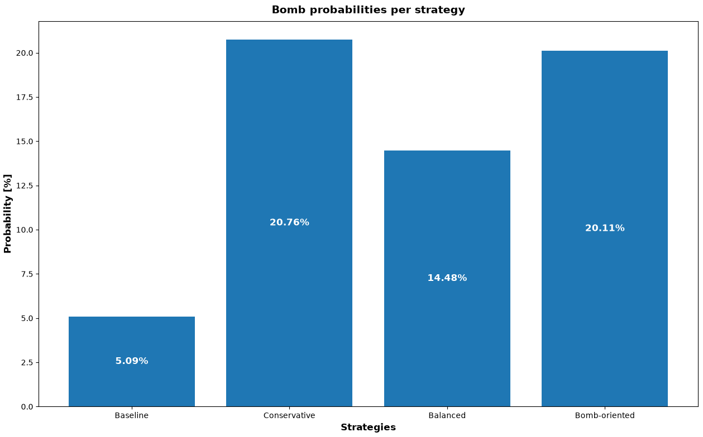

# Tichu bombs after exchange simulations

Monte Carlo experiments on Tichu deals (56 cards, 4 players × 14 cards), written in Python + NumPy.

- **`benchmark.py`** – estimates how often a player's hand holds a bomb (four of a kind, or a 5+ straight flush) *before* the card exchange.
- **`strategy1.py` / `strategy2.py` / `strategy3.py`** – three exchange heuristics (Conservative, Balanced, Bomb-oriented). Each gives every card a retention score and passes the three lowest-scoring cards, one to each other player. Existing bombs are locked and never passed. See `Heuristic rules.png` for the baseline rules.

Card IDs: `rank * 4 + suit` for 0–51 (rank 0 = 2 … 12 = Ace); 52 = Mah Jong, 53 = Dog, 54 = Phoenix, 55 = Dragon.

# Setup

A virtual environment should already exist in `venv/`.
From PowerShell:

```powershell
.\venv\Scripts\Activate.ps1
pip install -r requirements.txt
```

# Run the benchmark

```powershell
python .\benchmark.py
# Pre-exchange bomb probability: 5.0861% (50,861/1,000,000 player-hands)
```

Options:
* `--games N` (four-player deals, default `250000`)
* `--seed S` (default `20261115`)
* `--chunk-size C` (default `5000`).

# Run the strategies

Each strategy script takes the same options as the benchmark. It deals the same games (same seed), picks 3 cards per player to pass, does the exchange, and prints the share of hands holding a bomb **after** the exchange:

```powershell
python .\strategy1.py
python .\strategy2.py
python .\strategy3.py
```

All four players use the same strategy:
* Cards that are already part of a bomb are locked and never passed.
* Of the 3 cards passed, the lowest-scoring goes to the left opponent, the next goes to the right opponent, and the highest goes to the partner.


## Strategy 1: Conservative

**Holds the pairs and triples**, which are the building blocks of four-of-a-kind bombs.
- Triple bonus: 34 (kept even when the rank is part of a straight). Pair bonus: 8.
- Card rank counts for little (0.35 per rank). Ordinary straights get no bonus.
- Small same-suit neighbour bonuses (adjacent 1.2, two ranks apart 0.35, 4-card suited run 3).
- Special cards: Dragon 10, Phoenix 8, Mah Jong 5, Dog −2 (passed first).

## Strategy 2: Balanced

**Weighs bomb potential against ordinary hand strength.**
- Smaller triple/pair bonuses (14 / 6).
- A triple whose rank is part of an ordinary straight gets only 10, so it may be broken up.
- Rewards ordinary straights of length 3/4/5 (+3/+6/+9), counting only one copy of each rank.
- Rank weight 0.45. Same-suit bonuses: adjacent 2.0, two apart 0.8, 4-card suited run 7.
- Special cards: Dragon 9, Phoenix 8, Mah Jong 5, Dog 1.5.

## Strategy 3: Bomb-oriented

**Meant to go hardest for bombs**:
- Very large triple bonus (50)
- Strong same-suit bonuses aimed at straight flushes (adjacent 2.8, two apart 1.2, 4-card suited run 12)
- Low rank weight (0.15) and Dog −3.

## Results

* Default `250,000` deals = `1,000,000` player-hands
* Default seed `20261115`

| Script | Strategy | Bomb probability | vs. pre-exchange (5.09%) |
|---|---|---|---|
| `benchmark.py` | No exchange   | `5.0861%`  | Baseline |
| `strategy1.py` | Conservative  | `20.7582%` | ×4.1 |
| `strategy2.py` | Balanced      | `14.4762%` | ×2.8 |
| `strategy3.py` | Bomb-oriented | `20.1131%` | ×4.0 |


## Plots

The bar plot with probabilities is shown below:




# Takeaways

- Every strategy makes bombs much more common: `5.09%` before the exchange, `14–21%` after. *Because every player keeps their pairs and triples and passes away low single cards, the missing fourth card of a rank often arrives in the exchange.*
- **Conservative (`20.76%`) does best**, slightly ahead of Bomb-oriented (`20.11%`). Its bigger pair bonus (8 vs 3) seems to matter more than Bomb-oriented's strong same-suit bonuses: four-of-a-kind bombs come mostly from triples and pairs, not from straight flushes.
- **Balanced (`14.48%`)** gives up about 6 points of bomb rate to keep ordinary straights and high cards. This simulation does not measure whether that is worth it, because it only counts bombs, not hand strength or wins.
